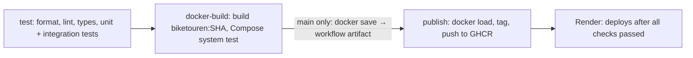

# Artifact Repository (P3b)

The CI pipeline publishes the Docker image that passed all tests to the **GitHub Container Registry (GHCR)** as `ghcr.io/cediackermann/biketouren`. Only commits on `main` are published. This document records the decisions and the evidence per assessment criterion. Untested points are marked as such.

## 1. Artifact type and repository

**Source code, build artifact, deployment artifact.** The source code is the repository. The build artifact is the Docker image `biketouren:<SHA>` that the `docker-build` job builds and tests. It becomes the deployment artifact once it is pushed to the registry with a fixed tag: a self-contained, versioned image that runs anywhere Docker runs, without the source code or Bun installed.

**Artifact type: container image.** The project is a web API, not a library: nobody installs it as a dependency, so an npm package would have no consumer. The app is already packaged as a Docker image (Dockerfile, Compose, CI system test, Render), so the image is the natural deployable result.

| Registry | Decision |
| --- | --- |
| **GitHub Container Registry** | **Chosen.** Same platform as the code and CI. The workflow's built-in `GITHUB_TOKEN` can push, so no extra secret is needed. Free for this repository. The image page links back to the repository and commit. |
| Docker Hub | Rejected: needs a separate account and an access token stored as a repository secret; the free plan limits pulls. |
| npm registry / GitHub Packages (npm) | Rejected: wrong artifact type for an app (see above). |
| Render's own build | Not a registry: Render builds the Dockerfile internally and keeps no versioned artifact that can be pulled elsewhere. |

## 2. Naming and versioning

- **Name:** `ghcr.io/<owner>/<app>` = `ghcr.io/cediackermann/biketouren`. Lowercase, as the registry requires. The app name matches the local image `biketouren` and the Render service.
- **`sha-<full commit SHA>`**: the version. Immutable by convention: the pipeline writes each SHA tag exactly once, so it always identifies the same image. This matches the versioning used everywhere else in the project (see [`cd-decisions.md`](cd-decisions.md), section 2): `/health` reports the same SHA, and the image carries it as `APP_VERSION` and as the OCI labels `org.opencontainers.image.revision` and `.version`.
- **`main`**: a moving tag that always points to the newest tested commit on `main`. Convenient for "give me the current production version", never used to identify a version.
- **No `latest`**: it is ambiguous (latest built? latest released?), and `main` says exactly what it is.
- **No SemVer:** every commit on `main` is deployed (Continuous Deployment), so there are no separate releases to number. If releases were introduced, a Git tag `v1.2.3` could additionally be pushed as image tag `1.2.3`; this is not implemented.
- **Branches and pull requests are not published.** Their images are built and tested in CI but discarded, so the registry only contains versions that are or were on `main`.

## 3. Registry setup

GHCR needs no manual setup: the first push of the workflow creates the package. Because the image carries the label `org.opencontainers.image.source=https://github.com/cediackermann/m324-gruppe3` and is pushed with this repository's `GITHUB_TOKEN`, GitHub links the package to the repository (visible under **Packages** on the repository page).

**Visibility:** a new package is private. To let anyone pull it without logging in, a repository admin sets it to public once: package page → **Package settings** → **Change visibility** → Public. The repository is public too, so a public image reveals nothing new. *Status: still to be done after the first publish.*

## 4. Pipeline integration

The P3 jobs `test` and `docker-build` are unchanged; [`ci.yml`](../../.github/workflows/ci.yml) adds two steps to `docker-build` and a new job `publish`:



- **Only after build and tests.** `publish` has `needs: docker-build`, which itself needs `test`. If any check fails, nothing is published.
- **Only on `main`.** `publish` and the save steps run only for `push` events on `refs/heads/main`.
- **The tested image is published, not a rebuild.** `docker-build` saves the exact image that passed the system test (`docker save`) and uploads it as a workflow artifact (kept for one day). `publish` loads it and pushes it. A second `docker build` could produce different bytes (for example a newer base image layer), and then the published artifact would not be the tested one.
- **Version in the output.** The `Report published artifact` step logs the image, tags, digest, and revision label, and writes them to the run's summary page.
- **Effect on deployment.** Render waits for *all* checks of a commit (see [`cd.md`](cd.md)), now including `publish`. If the push to GHCR fails, Render does not deploy that commit either, so every deployed commit also has a published image.

## 5. Access, permissions, and secrets

| Who | Access | How |
| --- | --- | --- |
| `publish` job | Push to packages of this repository | `GITHUB_TOKEN` with `permissions: packages: write` on this job only. The token is created per run, expires after the run, and cannot push to other repositories or packages. |
| `test`, `docker-build` jobs | No registry access | They do not declare `packages: write`. |
| Team members | Manage the package (visibility, delete versions) | Repository admin rights, through the package settings. |
| Everyone else | Pull only, once the package is public | No credentials needed. |

- **No stored secrets.** No personal access token, password, or registry credential is stored in the repository or in GitHub secrets. The token is passed to `docker login` via `--password-stdin` from an environment variable, so it never appears on a command line or in the log (GitHub also masks it).
- **No secrets in the image.** `DATABASE_URL` is provided at runtime (Render, Compose). `.dockerignore` keeps `.git`, tests, docs, and local database files out of the build context. The `app:app` credentials in Compose and CI belong to throwaway databases only.
- **If the package stays private**, pulling needs a personal access token with only the `read:packages` scope, stored in the consumer's secret store (for example Render's registry credentials). It must never be committed or pasted into an AI tool.

## 6. Evidence

*Pending: the first run on `main` after merging this change.* Record here:

- the CI run link and the output of the `Report published artifact` step (image, tags, digest),
- the package page: <https://github.com/cediackermann/m324-gruppe3/pkgs/container/biketouren>,
- a pull of the published tag and its version check:

  ```bash
  docker pull ghcr.io/cediackermann/biketouren:sha-<SHA>
  docker inspect --format '{{index .Config.Labels "org.opencontainers.image.revision"}}' ghcr.io/cediackermann/biketouren:sha-<SHA>
  ```

**Local validation on 2026-10-26** (before the first CI run): `APP_VERSION=localtest123 docker compose build app`, then Compose up, `/health` reported `"version":"localtest123"`, and the system smoke test passed. The image carried the expected OCI labels. `docker save | gzip` produced a 92 MB file, which `docker load` restored after the local image had been removed, the same steps the two jobs run. The workflow file passed a YAML lint; the GHCR push itself can only be tested in GitHub Actions.

## 7. Use in P4 (deployment and release)

- **Running a specific version anywhere.** Any tested version can be started without the source code, for example to reproduce a production bug locally or to give a tester an exact build:

  ```bash
  docker run --rm -p 3000:3000 -e DATABASE_URL=postgres://... ghcr.io/cediackermann/biketouren:sha-<SHA>
  ```

  `/health` then reports that SHA, so it is always clear which version is running.
- **Rollback.** The SHA tag of the previous good version stays in the registry and can be started again immediately, independent of Render's own rollback.
- **Render today.** Render currently builds the Dockerfile itself from the same commit (auto-deploy "After CI checks pass"). That build uses the same Dockerfile and lockfile but is a separate build, not the published image.
- **Next step (not implemented):** switch the Render service to "Deploy an existing image" with `ghcr.io/cediackermann/biketouren:sha-<SHA>`, triggered by the pipeline after `publish`. Then production would run exactly the tested and published bytes ("build once, deploy many"). This needs a way for CI to tell Render which tag to deploy (deploy hook or API), which was not available on the free plan in the CD work (see variant C in [`cd-decisions.md`](cd-decisions.md)); whether Render's free plan allows image-backed services was not verified.

## 8. AI review

| | |
| --- | --- |
| **Prompt** | "We have to do P3b (artifact repository) for our web app. I'm not sure artifacts make sense for it — maybe a pipeline that mocks it?" (with the assignment text; no tokens or credentials shared) |
| **AI suggestion** | Not a mock: the Docker image the pipeline already builds is a real deployment artifact. Publish it to GHCR with the built-in `GITHUB_TOKEN` (no stored secret), tags `sha-<SHA>` and `main`, only on `main`. Push the image that passed the system test via `docker save`/`docker load` in a separate job instead of rebuilding it. Bake the SHA into the image (`APP_VERSION`, OCI labels). |
| **Checked** | `ci.yml` (job order, `needs`, `if`, `permissions`), Dockerfile labels, `docker-compose.yml` build args, a local build/test/save/load run. |
| **Result** | The local run worked. It showed one problem the AI had not anticipated: the image inherited Bun's OCI labels (`description`, `url`, `version: 1.3.13`), so GHCR would have described the image as Bun. Fixed by overriding them in the Dockerfile. |
| **Conclusion** | Adopted. The suggestion fits the existing SHA-based versioning and needs no new secret. The point that `publish` now also gates Render's deploy is accepted on purpose. The GHCR push and the package linking are still to be confirmed in the first `main` run (section 6). |
