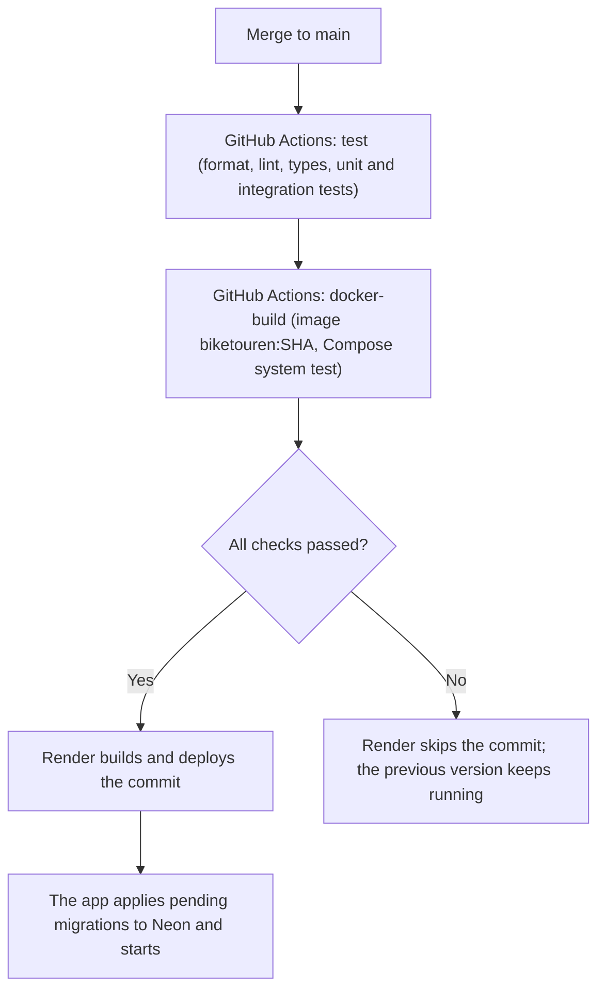

# Continuous Deployment

Every commit on `main` that passes all CI checks is deployed to production automatically. Production runs on free tiers: the API on [Render](https://render.com) (Docker web service) and the database on [Neon](https://neon.tech) (PostgreSQL). Neither needs a credit card.

Live: <https://m324-gruppe3.onrender.com/health>

Why this solution was chosen, the variants that were tried, and the evidence for each assessment criterion are in [`cd-decisions.md`](cd-decisions.md).

## How it works

- **GitHub Actions** ([`.github/workflows/ci.yml`](../../.github/workflows/ci.yml)) runs the `test` and `docker-build` jobs on every push to `main`, as on every branch and pull request.
- **Render** watches `main` with the auto-deploy trigger **After CI checks pass** ([`render.yaml`](../../render.yaml)). It waits until every check on the new commit has finished. If all of them succeed, it builds the Dockerfile and deploys that commit. If any check fails, it does not deploy, and the previous version keeps running. Render only deploys when files under `Code/` (its root directory) change.
- **On startup** the app applies pending database migrations to Neon, then starts serving requests (see the migration notes in [`src/shared/migrations.ts`](../src/shared/migrations.ts)).
- **`GET /health`** queries the database and reports the running commit in `version` (Render sets `RENDER_GIT_COMMIT`), so you can always see which commit is live.

Render's deploy hooks are not used: since Render's 2026 plan change they belong to the paid plans, and the "After CI checks pass" trigger gives the same quality gate on the free plan.

## One-time setup

### 1. Neon (database)

1. Sign up at [neon.tech](https://neon.tech) and create a project. Choose the region **AWS Europe Central 1 (Frankfurt)**, next to the Render region.
2. On the project dashboard, click **Connect** and copy the connection string. Turn **Connection pooling off** to get the direct connection (the host must not contain `-pooler`).
3. Keep `?sslmode=require` at the end. Remove `&channel_binding=require` if it is there; Bun's PostgreSQL client is not confirmed to support channel binding.

The tables are created automatically: the app applies pending migrations on startup.

### 2. Render (API)

Either **New → Blueprint** with this repository (Render reads [`render.yaml`](../../render.yaml)), or **New → Web Service** with these values:

| Setting | Value |
| --- | --- |
| Language | Docker |
| Branch | `main` |
| Root Directory | `Code` |
| Region | Frankfurt |
| Instance Type | Free |
| Health Check Path | `/health` |
| Auto-Deploy | **After CI Checks Pass** |
| Environment variable | `DATABASE_URL` = the Neon connection string |

After the first deploy, `https://<service>.onrender.com/health` should return `"status":"ok"`, `"database":"ok"`, and a `version`.

## Secrets

- The database connection string exists only in Render's environment settings. It is never in the repository, in CI logs, or in the image.
- GitHub Actions needs no deployment credentials at all.
- The `app:app` credentials in `docker-compose.yml` and `ci.yml` belong to throwaway local and CI databases only.

## Monitoring

- **Health:** `/health` queries the database. Render uses it as the service's health check (`healthCheckPath`).
- **Which version is live:** compare `version` from `/health` with `git log origin/main -1`.
- **Logs and metrics:** the Render dashboard shows deploy events, request logs, CPU, and memory; Neon shows database usage.
- **Alerts:** Render can email on failed deploys (Settings → Notifications). For uptime alerts, a free external monitor (for example UptimeRobot) can poll `/health`. Note that this also keeps the free service awake.

## Rollback

There is no automatic rollback. If a deployed version misbehaves:

- in the Render dashboard, open **Events**, pick an earlier successful deploy, and choose **Rollback** (this also pauses auto-deploy until you turn it back on), or
- revert the commit on `main`; once CI passes, Render deploys the revert like any other change.

Database migrations are not rolled back. Write them so that the previous app version still works with the new schema (for example, add columns instead of renaming them).

## Free-tier limits

- The free Render service sleeps after about 15 minutes without requests. The next request takes up to a minute.
- Render's free instance hours and Neon's free storage and compute are limited per month. One sleeping service and a small database stay well within them.
- Free tiers change. Check the current pricing pages if something stops working.
