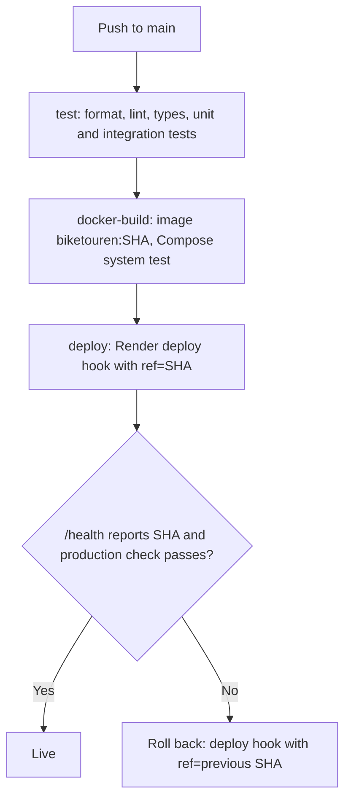

# Continuous Deployment

Every push to `main` that passes all CI checks is deployed to production automatically. Production runs on free tiers: the API on [Render](https://render.com) (Docker web service) and the database on [Neon](https://neon.tech) (PostgreSQL). Neither needs a credit card.

## How the deploy job works

The `deploy` job in [`.github/workflows/ci.yml`](../../.github/workflows/ci.yml) runs only for pushes to `main`, after `test` and `docker-build` have passed. Pull requests and other branches never deploy.

1. **Remember the live version.** `GET /health` returns the running commit SHA in `version` (Render sets `RENDER_GIT_COMMIT`). That SHA is the rollback target.
2. **Deploy the tested commit.** The job calls the Render deploy hook with `ref=<commit SHA>` ([`scripts/render-deploy.sh`](../scripts/render-deploy.sh), which also strips whitespace and quotes that a pasted secret may carry), so Render builds exactly the commit that passed CI, not whatever is newest on `main`. Render's own auto-deploy is off (`render.yaml`), so nothing reaches production without passing CI.
3. **Wait until it is live.** [`scripts/wait-for-version.sh`](../scripts/wait-for-version.sh) polls `/health` until it reports the new SHA (up to 15 minutes, including Render's build and the wake-up of a sleeping free service).
4. **Check production.** Read-only requests to `/health`, `/bikes`, and `/tours`. The full write workflow already ran against the same image in `docker-build`, so production data stays free of test records.
5. **Roll back on failure.** If any of these steps fails and a different version was live before, the job deploys the previous SHA through the same hook and waits for it. If the new version never went live (for example, the Render build failed), the old one is still serving and nothing is rolled back.

On `main`, a newer push does not cancel a running pipeline, so a deploy can always finish its check and rollback. Each run shows up under the repository's **Environments → production** with a link to the live URL.

## One-time setup

### 1. Neon (database)

1. Sign up at [neon.tech](https://neon.tech) and create a project. Choose the region **AWS Europe Central 1 (Frankfurt)**, next to the Render region.
2. On the project dashboard, click **Connect** and copy the connection string. Turn **Connection pooling off** to get the direct connection (the host must not contain `-pooler`).
3. Keep `?sslmode=require` at the end. Remove `&channel_binding=require` if it is there; Bun's PostgreSQL client is not confirmed to support channel binding.

The tables are created automatically: the app applies pending migrations on startup.

### 2. Render (API)

1. Sign up at [render.com](https://render.com) with GitHub and allow access to this repository.
2. **New → Blueprint**, select this repository. Render reads [`render.yaml`](../../render.yaml) and creates the free web service `biketouren` in Frankfurt.
3. When asked for `DATABASE_URL`, paste the Neon connection string. It is stored only in Render.
4. Wait for the first deploy, then open `https://<service>.onrender.com/health`. It should return `"status":"ok"` and a `version`.
5. In the service, open **Settings → Deploy Hook** and copy the URL.

### 3. GitHub (pipeline)

In the repository, open **Settings → Secrets and variables → Actions**:

| Kind | Name | Value |
| --- | --- | --- |
| Secret | `RENDER_DEPLOY_HOOK_URL` | The deploy hook URL. Anyone with it can trigger deploys, so it is a secret. |
| Variable | `PRODUCTION_URL` | `https://<service>.onrender.com`, without a trailing slash |

The next push to `main` deploys. If either value is missing, the deploy job fails with a message pointing here.

Optional: under **Settings → Environments → production**, add **Required reviewers**. The deploy job then waits for an approval, which turns continuous deployment into continuous delivery (available for free on public repositories).

## Secrets

- The database connection string exists only in Render's environment settings. It is never in the repository, in CI logs, or in the image.
- The deploy hook URL is a GitHub Actions secret; GitHub masks it in logs.
- The `app:app` credentials in `docker-compose.yml` and `ci.yml` belong to throwaway local and CI databases only.

## Monitoring

- **Health:** `/health` queries the database. Render uses it as the service's health check (`healthCheckPath` in `render.yaml`), and the pipeline checks it after every deploy.
- **Logs and metrics:** the Render dashboard shows request logs, CPU, and memory; Neon shows database usage.
- **Alerts:** Render can email on failed deploys (Settings → Notifications). For uptime alerts, a free external monitor (for example UptimeRobot) can poll `/health`. Note that this also keeps the free service awake.

## Manual rollback

- In the Render dashboard, open **Events**, pick an earlier successful deploy, and choose **Rollback**, or
- call the deploy hook with an older commit: `curl -X POST "$RENDER_DEPLOY_HOOK_URL&ref=<sha>"`, or
- revert the commit on `main`; the pipeline deploys the revert like any other change.

Database migrations are not rolled back. Write them so that the previous app version still works with the new schema (for example, add columns instead of renaming them).

## Free-tier limits

- The free Render service sleeps after about 15 minutes without requests. The next request takes up to a minute.
- Render's free instance hours and Neon's free storage and compute are limited per month. One sleeping service and a small database stay well within them.
- Free tiers change. Check the current pricing pages if something stops working.
